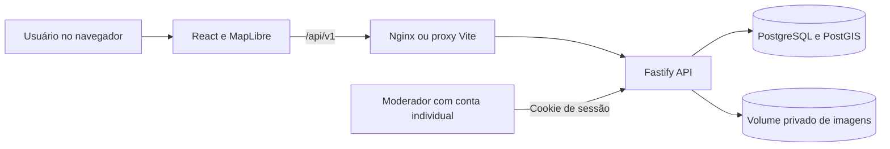

# Documentação técnica da plataforma Raiz

## 1 Finalidade e escopo

Este documento descreve o estado técnico do MVP Raiz usado no TCC de Análise e Desenvolvimento de Sistemas. Ele diferencia o que está implementado, o que existe parcialmente e o que permanece planejado. A fonte de verdade é o código do repositório na versão submetida à avaliação.

O sistema apoia estes objetivos específicos do TCC:

1. **Modelar os requisitos, as regras de negócio e a arquitetura de uma plataforma de ocorrências ambientais que diferencie ocorrências de relatos.**
2. **Implementar uma aplicação web responsiva com mapa, filtros, registro de relatos, sugestão de ocorrências próximas e confirmação de problemas existentes.**
3. **Implementar controles básicos de qualidade e segurança, incluindo limitação por IP, pseudonimização, validação de dados, processamento de imagens e moderação protegida.**

## 2 Atores

| Ator | Responsabilidades e permissões |
|---|---|
| Visitante | Consultar mapa, categorias e detalhes públicos sem autenticação. |
| Colaborador anônimo | Criar relato, anexar fotografia opcional e confirmar ocorrência, sujeito a quotas e validações. |
| Moderador | Alterar visibilidade, confiança ou ciclo de vida por conta individual; consultar histórico de ocorrências. |
| Proprietário (owner) | Moderar e gerenciar contas; consultar também auditoria de contas e autenticação. |
| Operador técnico | Configurar ambiente, banco, proxy, segredos, backup, monitoramento e atualizações. |

O MVP não possui conta pública. Administradores têm contas individuais no painel `/admin`; o primeiro owner é criado pelo CLI local e os demais pelo painel. Toda senha temporária exige troca no primeiro acesso.

## 3 Requisitos funcionais

| ID | Requisito | Estado | Evidência no projeto |
|---|---|---|---|
| RF-01 | Exibir ocorrências em mapa por bounding box | **Implementado** | `GET /api/v1/issues` e camada MapLibre |
| RF-02 | Filtrar por uma das seis categorias | **Implementado** | catálogo compartilhado e filtro do frontend |
| RF-03 | Exibir detalhe de ocorrência | **Implementado** | `GET /api/v1/issues/:id` |
| RF-04 | Criar relato anônimo com categoria e coordenadas | **Implementado** | `POST /api/v1/reports` multipart |
| RF-05 | Aceitar descrição e fotografia opcionais | **Implementado** | parser multipart e processamento de mídia |
| RF-06 | Sugerir ocorrências próximas da mesma categoria | **Implementado** | `GET /api/v1/issues/nearby` com `ST_DWithin` |
| RF-07 | Confirmar ocorrência ativa | **Implementado** | `POST /api/v1/issues/:id/confirmations` |
| RF-08 | Escalonar pin conforme quantidade de relatos | **Implementado** | propriedade `reportsCount` usada pelo mapa |
| RF-09 | Distinguir confiança, ciclo de vida e visibilidade | **Implementado** | colunas e tipos separados |
| RF-10 | Moderação administrativa | **Implementado** | painel com ações reversíveis, justificativa e papéis |
| RF-11 | Usar em desktop e celular | **Implementado** | layout React responsivo; requer avaliação em dispositivos reais |
| RF-12 | Instalação PWA | **Não implementado** | não há manifest ou service worker |
| RF-13 | Idempotência de publicação | **Não implementado** | não há `Idempotency-Key` persistida |
| RF-14 | Mesclar duplicatas | **Não implementado** | há sugestão prévia, mas não há merge administrativo |
| RF-15 | Auditoria administrativa | **Implementado** | eventos append-only e transacionais em admin_audit_events |
| RF-16 | Consultar resolvidas | **Implementado** | mapa e painel com período inclusivo de até 90 dias |

## 4 Requisitos não funcionais

| ID | Requisito | Estado e observação |
|---|---|
| RNF-01 Segurança | **Parcial.** Há contas individuais, RBAC, sessões revogáveis, auditoria, rede privada, HMAC e reprocessamento; MFA e revisão de segurança de produção permanecem pendentes. |
| RNF-02 Privacidade | **Parcial.** IP bruto não integra `reports`; faltam política operacional, retenção automatizada e canal formal de direitos. |
| RNF-03 Desempenho | **Parcial.** Índice GiST e consulta por bbox existem; limites e carga precisam ser medidos. |
| RNF-04 Disponibilidade | **Não validado.** O projeto possui health check e Compose, mas não há evidência de operação contínua. |
| RNF-05 Acessibilidade | **Parcial.** Há labels, componentes responsivos e feedback; auditoria WCAG 2.2 permanece pendente. |
| RNF-06 Portabilidade | **Implementado para desenvolvimento.** Docker Compose descreve banco, API e web; Docker precisa estar disponível. |
| RNF-07 Manutenibilidade | **Implementado em nível de MVP.** TypeScript, workspaces e pacote compartilhado reduzem divergência de tipos. |

## 5 Regras de negócio

- Uma ocorrência (`Issue`) representa o problema; um relato (`Report`) representa uma observação associada.
- Cada ocorrência nasce com pelo menos um relato e `report_count = 1`.
- Categoria, latitude e longitude são obrigatórias; descrição e fotografia são opcionais.
- Somente ocorrências `visible` são retornadas publicamente.
- Confirmações são aceitas apenas para ocorrências ativas e visíveis.
- O mesmo hash de IP não pode confirmar a mesma ocorrência novamente dentro de 24 horas.
- A criação usa duas janelas de quota: cinco publicações por hora e vinte por dia, configuráveis.
- Há limite adicional de trinta confirmações por dia, configurável.
- Três hashes de IP distintos associados à ocorrência podem elevar `unverified` para `corroborated`.
- `corroborated` não significa verificação oficial; `verified` depende da moderação.
- Fotos aceitas são reprocessadas em JPEG e perdem metadados EXIF.
- O cliente nunca pode enviar ou alterar diretamente contadores, hashes ou estados administrativos.

## 6 Arquitetura

### 6.1 Frontend

No detalhe administrativo, as coordenadas abrem uma prévia MapLibre com marcador após 250 ms de hover, por foco de teclado ou por toque. Escape ou saída do foco fecha a prévia. O mapa é carregado sob demanda; um link abre o mapa principal centralizado nas coordenadas, e uma mensagem informa indisponibilidade do provedor de tiles.

O frontend está em `apps/web`. Utiliza React, Vite, TypeScript, MapLibre GL JS e ícones Lucide. O componente de mapa consulta a API conforme os limites da viewport. O Vite encaminha `/api` para `localhost:3001` no desenvolvimento. Em produção Docker, Nginx hospeda o build estático e atua como proxy.

### 6.2 Backend

A API está em `apps/api`. Fastify registra rotas, hooks e tratamento de erros. Zod valida dados de relato, coordenadas, UUIDs e atualizações administrativas. O módulo de banco usa pool `pg`; o módulo de mídia reprocessa arquivos com Sharp; segurança e limitação estão isoladas em módulos próprios.

### 6.3 Banco e PostGIS

O schema habilita `postgis` e `pgcrypto`. As tabelas principais são:

- `issues`: categoria, descrição, ponto `GEOGRAPHY(POINT,4326)`, contadores e estados;
- `reports`: ocorrência, hash do IP, tipo, descrição, mídia e data;
- `media_files`: chave privada, tipo, dimensões e data;
- `admin_accounts`: identidade, hash scrypt, papel, bloqueio e troca obrigatória;
- `admin_sessions`: hash do token, conta e expiração;
- `admin_audit_events`: autor, alvo, ação, antes/depois, justificativa e instante;
- `schema_migrations`: controle de migrações aplicadas.

O índice GiST em `issues.location` apoia consultas espaciais. `ST_DWithin` encontra ocorrências próximas em metros. A ordem das coordenadas é longitude e latitude.

### 6.4 Infraestrutura

O Compose define três serviços: `db`, `api` e `web`. Apenas o Nginx é exposto publicamente na porta configurada. A API permanece na rede privada com endereço fixo, permitindo confiar exclusivamente no proxy definido. Volumes persistem banco e imagens.

## 7 Contrato HTTP

| Método | Rota | Uso | Banco |
|---|---|---|---|
| GET | `/api/v1/health` | Verificar conexão | Sim |
| GET | `/api/v1/categories` | Obter catálogo | Não |
| GET | `/api/v1/issues` | Consultar GeoJSON por bbox e categoria | Sim |
| GET | `/api/v1/issues/nearby` | Encontrar possíveis duplicidades | Sim |
| GET | `/api/v1/issues/:id` | Obter detalhe | Sim |
| GET | `/api/v1/media/:id` | Servir JPEG de ocorrência visível | Sim |
| POST | `/api/v1/reports` | Criar ocorrência e relato | Sim |
| POST | `/api/v1/issues/:id/confirmations` | Confirmar problema ativo | Sim |
| GET | `/api/v1/admin/issues` e `/issues/:id` | Fila e detalhe privados | Sim e sessão |
| POST | `/api/v1/admin/issues/:id/actions` | Transição com justificativa | Sim e sessão |
| GET | `/api/v1/admin/history` | Auditoria por papel | Sim e sessão |
| POST | `/api/v1/admin/login`, `/logout`, `/password` | Autenticação e senha | Sim |
| GET | `/api/v1/admin/session` | Conta atual | Sim e sessão |
| GET/POST | `/api/v1/admin/accounts` | Listar/criar contas | Sim e owner |
| PATCH | `/api/v1/admin/accounts/:id` | Ativar/desativar | Sim e owner |
| POST | `/api/v1/admin/accounts/:id/reset-password` | Redefinir senha | Sim e owner |
| GET | `/api/v1/admin/media/:id` | Fotos inclusive ocultas | Sim e sessão |

Erros usam corpo com `error` e `message`. Excesso de quota retorna 429 com `Retry-After`. Payload inválido recebe 400; mídia acima do limite pode receber 413.

## 8 Controles de segurança

### 8.1 Origem de rede

`X-Forwarded-For` somente é confiável quando a conexão vem dos proxies configurados. IPv6 é normalizado por prefixo `/64` como heurística. O endereço normalizado é transformado com HMAC-SHA-256 e segredo do servidor antes de persistir em relatos.

### 8.2 Mídia

O backend limita o tamanho, decodifica a entrada com Sharp, aplica rotação baseada em metadados, redimensiona e grava JPEG com nome aleatório. A versão pública é entregue apenas quando associada a ocorrência visível. Permanecem **não implementados**: antivírus, detecção de conteúdo, desfocagem, object storage e aprovação humana de cada imagem.

### 8.3 Administração

Contas usam scrypt com salt aleatório; sessões opacas de 8 horas têm somente o hash persistido. Cookie HttpOnly/SameSite=Strict, Secure fora do local, e validação de Origin protegem as mutações. Cinco erros bloqueiam por 15 minutos. Logout, troca/redefinição de senha e desativação revogam sessões. O último owner ativo é protegido por trava transacional.

As ações verify/unverify, resolve/reopen e hide/restore são independentes. Cada ação bloqueia a ocorrência com `FOR UPDATE`, muda estado e insere evento na mesma transação. Ações repetidas retornam 409. Triggers impedem UPDATE/DELETE de auditoria, sem pretender proteger contra um superusuário do banco. Desverificar recalcula corroborated para três ou mais fontes distintas. IP/HMAC nunca integra o contrato administrativo; apenas agregados e alerta de concentração são exibidos.

Listas têm 25 itens por página, máximo 100. Resolvidas usam `resolved_at`, limites inclusivos por dia em São Paulo e máximo 90 dias; ativas permanecem na consulta. Reabrir limpa resolved_at e preserva os eventos. A migração é automática e idempotente; datas de resolvidas legadas usam last_report_at como aproximação.

## 9 Rastreabilidade

| Objetivo do TCC | Requisitos relacionados | Avaliação prevista |
|---|---|---|
| Modelar requisitos e arquitetura | RF-01 a RF-15, RNF-01 a RNF-07 | Revisão da matriz e consistência com código |
| Implementar aplicação responsiva | RF-01 a RF-08 e RF-11 | Casos funcionais e inspeção em larguras definidas |
| Implementar controles | RF-09, RF-10, RNF-01 e RNF-02 | Testes de quota, IP, mídia e autenticação |
| Verificar o artefato | Todos | Plano técnico em `testes-e-avaliacao.md` |
| Analisar limitações, riscos e prontidão | Todos | Checklist técnico, matriz de riscos e decisão de prontidão |

## 10 Decisões e limitações

- **Monólito modular:** reduz operação no piloto; os módulos permanecem no mesmo processo.
- **Sem contas públicas:** reduz fricção; limita reputação e recuperação de bloqueios.
- **Rate limit em memória:** simples para uma instância; reinícios apagam quotas e réplicas não compartilham estado.
- **IP como sinal:** útil para contenção básica; NAT gera falsos positivos e VPN permite evasão.
- **Contagem acumulada:** `report_count` não representa chaves únicas em janela móvel, divergindo da proposta de `displayCount30d`.
- **Storage local:** suficiente para demonstração; exige migração para armazenamento de objetos em escala.
- **Sugestão sem merge:** preserva escolha do usuário; permite duplicatas residuais.
- **Sem idempotência:** retries podem criar duplicidade de relatos.

## 11 Configuração mínima

Para execução completa são necessários Docker Engine e Compose v2, ou PostgreSQL 16 com PostGIS configurado manualmente. O arquivo `.env` deve conter segredos locais e nunca deve ser versionado. A publicação requer novos segredos, HTTPS, domínio, backup, monitoramento, política de privacidade e operação de moderação.
