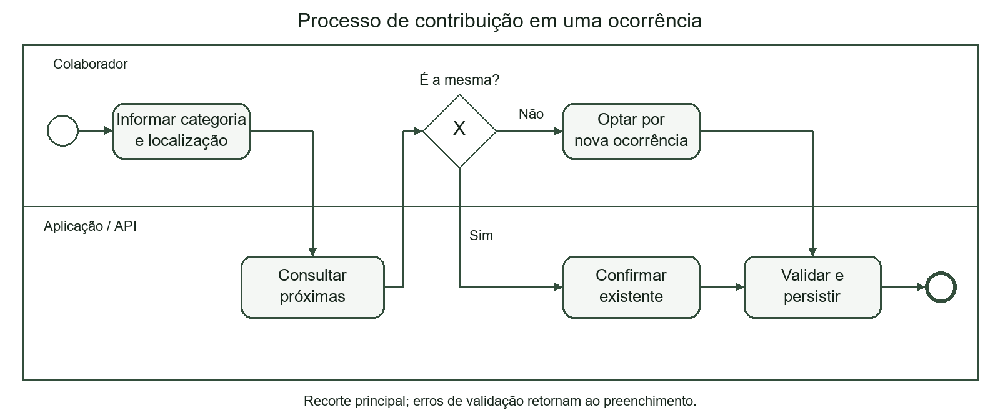
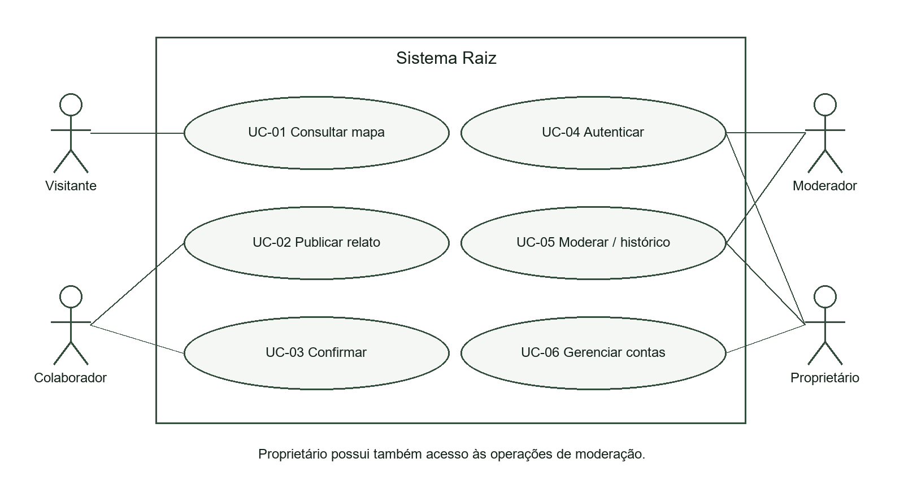
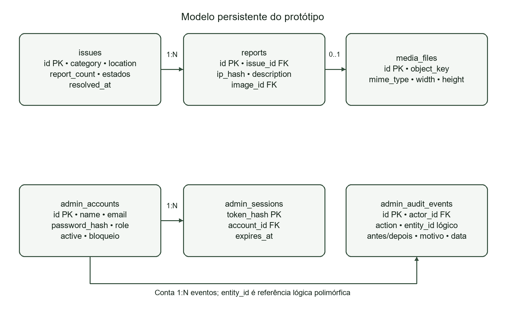
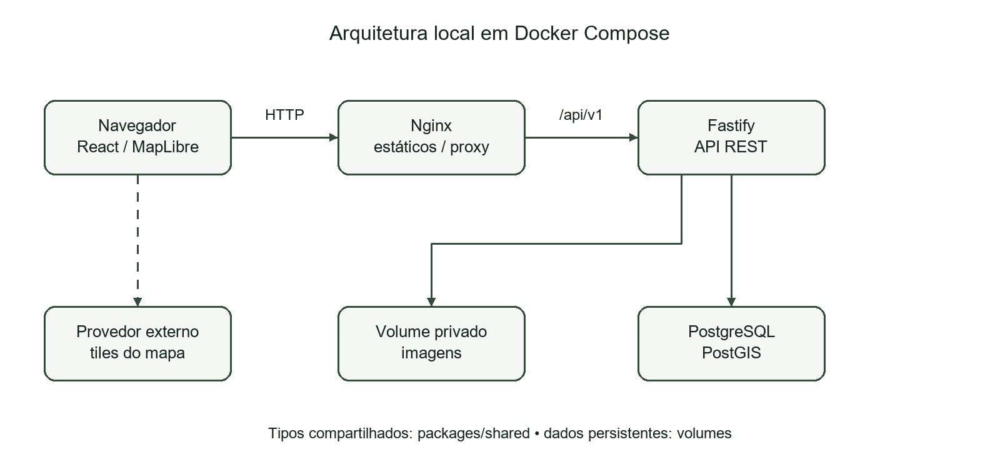
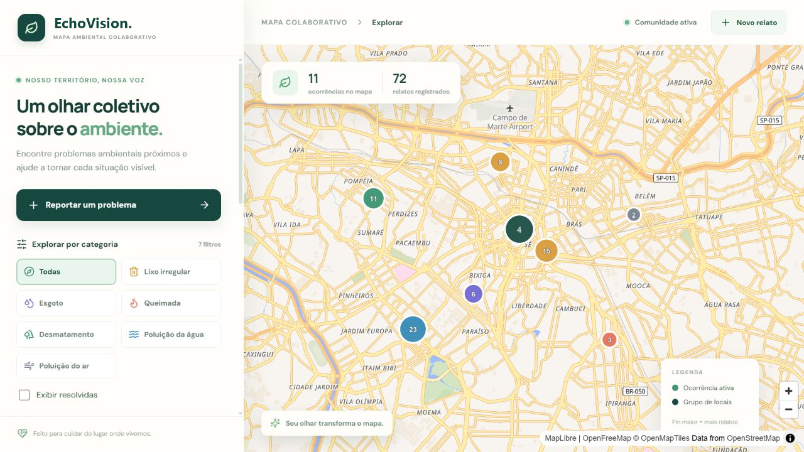
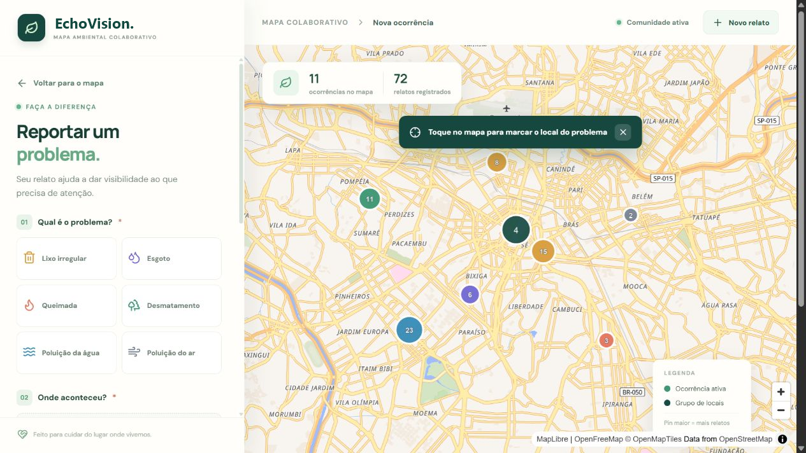
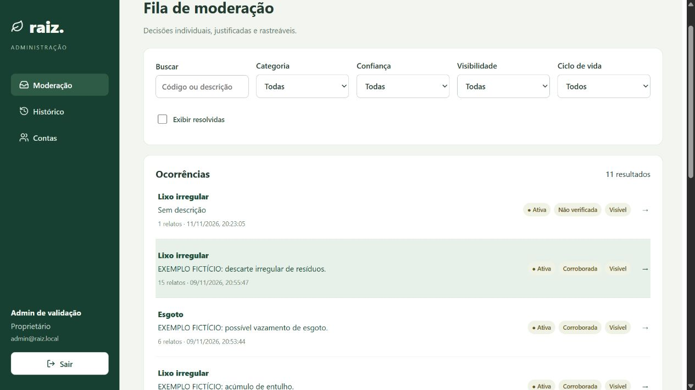
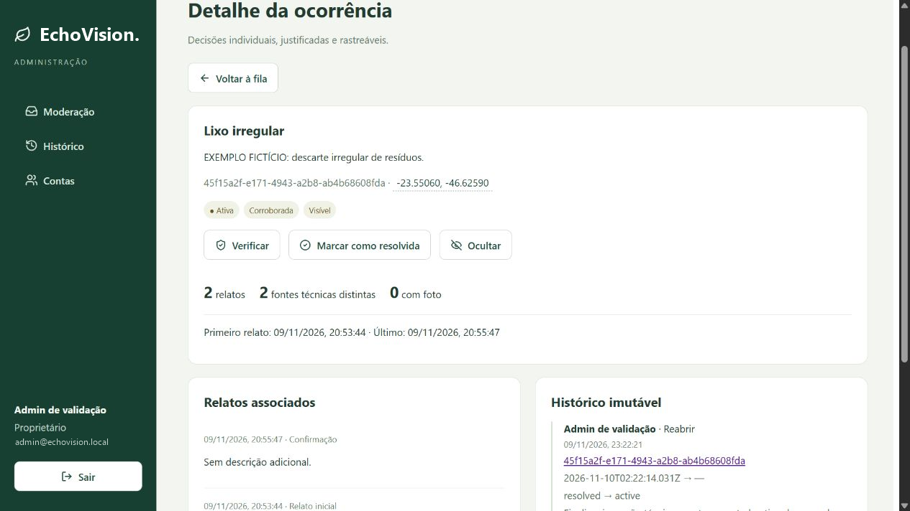

# Plataforma web colaborativa para registro e consulta de ocorrências ambientais

## Resumo

Ocorrências ambientais registradas em canais dispersos dificultam a consulta espacial e o acompanhamento de problemas locais. Este trabalho apresenta o desenvolvimento da plataforma Raiz, uma aplicação web que permite registrar relatos sem cadastro público, consultar ocorrências em mapa e confirmar problemas existentes. O objetivo foi construir e verificar um protótipo com organização geográfica, prevenção básica de abuso e moderação rastreável. O método combinou análise documental, inspeção do código, refinamento de requisitos, implementação incremental e testes técnicos com dados fictícios. A solução utiliza interface por componentes, interface de programação de aplicações, banco geoespacial, processamento de imagens e contas administrativas individuais. A distinção entre ocorrência e relato permite agregar observações sem confundir repetição com verificação oficial. Ações de moderação são reversíveis, exigem justificativa e preservam histórico. Na execução final, oito testes de servidor e nove de componentes foram aprovados. A compilação e a demonstração autenticada também foram verificadas. Os resultados sustentam os cenários técnicos documentados, mas não comprovam impacto ambiental, desempenho em escala ou prontidão para operação pública. O produto entregue inclui código, requisitos, modelos, documentação de implantação e evidências de avaliação.

**Palavras-chave:** Aplicação web. Informação geográfica. Ocorrências ambientais. Qualidade de software. Sistemas colaborativos.

## Abstract

Environmental reports distributed across separate channels make spatial consultation and local issue tracking difficult. This work presents Raiz, a web application for public reporting without registration, map consultation, and confirmation of existing issues. The objective was to build and verify a prototype combining geographic organization, basic abuse prevention, and traceable moderation. The method combined document analysis, source-code inspection, requirements refinement, incremental implementation, and technical testing with fictitious data. The solution uses a component-based interface, an application programming interface, a spatial database, image processing, and individual administrative accounts. Separating issues from reports allows observations to be aggregated without treating repetition as official verification. Moderation actions are reversible, require a reason, and preserve history. In the final execution, eight server tests and nine component tests passed. Compilation and an authenticated demonstration were also verified. The results support the documented technical scenarios but do not establish environmental impact, performance at scale, or readiness for unrestricted public operation. Deliverables include source code, requirements, models, deployment documentation, and evaluation evidence.

**Keywords:** Collaborative systems. Environmental occurrences. Geographic information. Software quality. Web application.

## 1 Introdução

Problemas como descarte irregular, esgoto e queimadas podem ser percebidos por pessoas próximas antes de serem consolidados em uma base de consulta. Quando as observações permanecem em mensagens e publicações isoladas, torna-se difícil localizar recorrências e acompanhar seu estado. O problema tratado é a organização dessas contribuições, sem presumir que todo relato corresponda a um fato oficialmente comprovado.

A questão de projeto foi: como implementar uma aplicação colaborativa para registrar, consolidar e consultar ocorrências ambientais sem cadastro público obrigatório, mantendo controles básicos de qualidade, privacidade e prevenção de abuso? A proposição foi separar o problema observado de suas contribuições, sugerir ocorrências próximas e manter confiança, ciclo de vida e visibilidade independentes.

O objetivo geral foi desenvolver e verificar tecnicamente um protótipo web de registro e consulta geográfica de ocorrências ambientais. Os objetivos específicos foram modelar requisitos e regras; implementar consulta, registro e confirmação; introduzir privacidade e moderação; verificar fluxos locais; e analisar limitações para evolução operacional.

O tema reúne desafios de Análise e Desenvolvimento de Sistemas: requisitos, dados geoespaciais, interface responsiva, programação de servidor, segurança e testes. A contribuição simplificada exige limites transparentes: redes compartilhadas e serviços de intermediação impedem tratar endereço de rede como identidade pessoal. Repetição não certifica veracidade, e fotografias podem conter conteúdo sensível.

O projeto partiu de um pacote funcional recebido, inspecionado e ampliado. O histórico Git foi reorganizado retrospectivamente; suas datas não comprovam atividades. A avaliação utilizou análise documental e testes fictícios, sem entrevistas ou pesquisa de campo. O relatório segue a modalidade Projeto de Software de ADS da Fatec Franca (2023), apresentando requisitos, métodos, desenvolvimento e resultados.

### 1.1 Termo de abertura do projeto

O termo de abertura consolida objetivo, entregáveis, fronteiras e responsabilidades. Seu papel é tornar o escopo verificável, em consonância com a organização do projeto e da relatoria descrita nas diretrizes da Fatec Franca (2023). O Quadro 1 registra o projeto apresentado; não representa aprovação institucional retroativa.

Quadro 1 - Termo de abertura do projeto Raiz

| Campo | Definição |
|---|---|
| Projeto | Plataforma web colaborativa para registro e consulta de ocorrências ambientais |
| Autores | Guilherme Henrique Campos da Silva; André Luis Maia Junior |
| Orientador informado | Leonardo Henrique Raiz |
| Instituição e curso | Fatec Franca Dr. Thomaz Novelino; Tecnologia em Análise e Desenvolvimento de Sistemas |
| Objetivo e entregáveis | Protótipo web, API, banco espacial, painel, código, requisitos, modelos, documentação e evidências |
| Incluído | Mapa, categorias, relatos, foto, proximidade, confirmação, limites e administração auditável |
| Excluído | Atendimento por autoridades, comprovação automática, aplicativo nativo, PWA, mesclagem e lançamento público |
| Aceite técnico | Compilação, testes registrados e demonstração local dos fluxos essenciais |
| Restrições e riscos | Prazo acadêmico, dados fictícios, sem campo, tiles externos e infraestrutura de uma instância |
| Marco de entrega | Versão acadêmica de 2026; data exata e aceite formal definidos pela instituição |

Fonte: elaboração dos autores (2026).

## 2 Levantamento de requisitos

### 2.1 Elicitação e especificação

Requisitos descrevem comportamentos e restrições que permitem verificar uma solução. A orientação de engenharia de sistemas da NASA (2016) recomenda enunciados claros, verificáveis e rastreáveis. A elicitação ocorreu pela leitura do design e do README, confronto com o código e refinamento das decisões de moderação. O Apêndice A registra as decisões, sem apresentá-las como entrevistas com usuários externos.

Os perfis são visitante, colaborador, moderador e proprietário. Visitantes consultam; colaboradores publicam e confirmam; moderadores alteram ocorrências; proprietários também gerenciam contas. O operador técnico configura banco, rede, segredos e backups. A API aplica a autorização independentemente dos botões da interface.

### 2.2 Modelo de processo em BPMN

A BPMN representa processos por eventos, atividades, decisões e conexões (OMG, 2013). A Figura 1 mostra o fluxo de publicação: informar categoria e local, consultar próximos, decidir por confirmação ou nova ocorrência e validar a operação. A rejeição devolve o fluxo para correção; proximidade não determina duplicidade automaticamente.

Figura 1 - Processo de registro e confirmação de ocorrência



Fonte: elaboração dos autores (2026), com notação baseada em OMG (2013).

### 2.3 Requisitos funcionais

O Quadro 2 apresenta funções rastreadas e seu estado. Os três itens de evolução explicitam diferenças entre a proposta inicial e a entrega; não são funcionalidades implicitamente concluídas.

Quadro 2 - Requisitos funcionais

| ID | Comportamento esperado | Prioridade | Estado |
|---|---|---|---|
| RF-01 | Consultar ocorrências visíveis por caixa geográfica | Alta | Implementado |
| RF-02 | Filtrar por uma das seis categorias | Alta | Implementado |
| RF-03 | Exibir descrição, quantidade, foto e estados no detalhe | Alta | Implementado |
| RF-04 | Criar ocorrência e relato inicial com categoria e coordenadas válidas | Alta | Implementado |
| RF-05 | Aceitar descrição até 500 caracteres e foto JPEG/PNG/WebP até 8 MB | Alta | Implementado |
| RF-06 | Sugerir até cinco ocorrências próximas da mesma categoria | Alta | Implementado |
| RF-07 | Confirmar ocorrência ativa e visível | Alta | Implementado |
| RF-08 | Dimensionar pontos pela quantidade acumulada | Média | Implementado |
| RF-09 | Distinguir confiança, ciclo e visibilidade | Alta | Implementado |
| RF-10 | Moderar com conta individual e justificativa | Alta | Implementado |
| RF-11 | Disponibilizar interface responsiva | Alta | Implementado |
| RF-12 | Instalação PWA e operação offline | Baixa | Evolução |
| RF-13 | Persistir chave de idempotência de publicação | Média | Evolução |
| RF-14 | Mesclar ocorrências duplicadas | Média | Evolução |
| RF-15 | Auditar autor, alvo, ação, antes/depois e instante | Alta | Implementado |
| RF-16 | Exibir resolvidas opcionalmente por até 90 dias | Média | Implementado |

Fonte: elaboração dos autores (2026), a partir dos contratos implementados.

### 2.4 Requisitos não funcionais

O Quadro 3 delimita qualidade e operação. Existência de um controle não implica aprovação integral da categoria: autenticação individual, por exemplo, não substitui auditoria de segurança.

Quadro 3 - Requisitos não funcionais

| ID | Exigência | Verificação e limite |
|---|---|---|
| RNF-01 | Administração restrita por sessão e papel | Testes de acesso e revogação; MFA ausente |
| RNF-02 | Evitar IP bruto persistido e identificadores expostos | HMAC e agregados; retenção operacional pendente |
| RNF-03 | Apoiar consulta espacial indexada | PostGIS/GiST; p95 e carga não medidos |
| RNF-04 | Implantação local reproduzível | Compose e health check; sem garantia de disponibilidade |
| RNF-05 | Rótulos, foco e alternativas textuais | Inspeção parcial; contraste/leitor de tela sem auditoria integral |
| RNF-06 | Portabilidade para ambientes Docker compatíveis | Windows/Docker ensaiado; outros hosts não verificados |
| RNF-07 | Contratos tipados e verificações automatizadas | TypeScript e testes; cobertura não integral |

Fonte: elaboração dos autores (2026).

### 2.5 Regras de negócio

O Quadro 4 registra os valores padrão e as restrições do código, sem apresentá-los como recomendações universais de operação.

Quadro 4 - Regras de negócio

| ID | Regra |
|---|---|
| RN-01 | Ocorrência representa o problema; relatos representam suas observações |
| RN-02 | Somente ocorrências visíveis aparecem nas consultas públicas |
| RN-03 | Confirmação exige ativa/visível; mesma fonte não repete em 24 horas |
| RN-04 | Quotas padrão: 5 publicações/hora, 20/dia e 30 confirmações/dia |
| RN-05 | Três fontes podem gerar corroborated; verified depende de moderação |
| RN-06 | Resolver mantém relatos; reabrir limpa resolved_at e preserva eventos |
| RN-07 | Mudança administrativa exige justificativa de 3 a 1000 caracteres |
| RN-08 | Owner gerencia contas; moderator não recebe eventos de contas/autenticação |
| RN-09 | Senha mínima de 12 caracteres, sessão de 8 horas, cinco falhas bloqueiam por 15 minutos |
| RN-10 | Logout, troca/redefinição de senha e desativação revogam sessões |
| RN-11 | Último owner ativo não pode ser desativado pelo painel |
| RN-12 | Resolvidas: dias inclusivos em America/Sao_Paulo, máximo 90 dias |

Fonte: elaboração dos autores (2026).

### 2.6 Casos de uso

Casos de uso descrevem interações que atendem objetivos dos atores (OMG, 2017). A Figura 2 delimita a aplicação e o Quadro 5 relaciona os cenários. Proprietários possuem também as permissões dos moderadores.

Figura 2 - Diagrama de casos de uso



Fonte: elaboração dos autores (2026), com notação baseada em OMG (2017).

Quadro 5 - Índice de casos de uso

| ID | Objetivo | Ator | Requisitos |
|---|---|---|---|
| UC-01 | Consultar mapa e detalhe | Visitante | RF-01, 02, 03, 08, 16 |
| UC-02 | Publicar relato e foto opcional | Colaborador | RF-04, 05, 06 |
| UC-03 | Confirmar ocorrência existente | Colaborador | RF-06, 07 |
| UC-04 | Autenticar e encerrar sessão | Administrador | RF-10 |
| UC-05 | Moderar e consultar histórico | Moderador/owner | RF-09, 10, 15, 16 |
| UC-06 | Gerenciar contas | Proprietário | RF-10, 15 |

Fonte: elaboração dos autores (2026).

Os Quadros 6 e 7 especificam precondições, sequência principal e recuperação. A documentação de uma alternativa não significa que todos os seus caminhos foram executados na avaliação.

Quadro 6 - Especificação dos casos públicos

| Caso | Pré-condição e fluxo principal | Alternativas e pós-condição |
|---|---|---|
| UC-01 | API disponível. Abrir mapa; consultar área; escolher categoria; selecionar ocorrência; examinar detalhe; opcionalmente habilitar resolvidas e período | Área/período inválido: erro. Área vazia: informação. Pós: consulta sem alteração de dados |
| UC-02 | Categoria/local selecionados. Preencher opcionais; consultar próximos; optar por novo; enviar; validar, processar foto e gravar ocorrência/relato | Foto inválida ou quota excedida: rejeição. Pós: ocorrência ativa, visível, não verificada com relato inicial |
| UC-03 | Ativa e visível. Confirmar; verificar janela/quota; inserir relato e incrementar contador; recalcular corroboração | Fonte recente/resolvida: 409; oculta/inexistente: 404. Pós: confirmação persistida uma vez |

Fonte: elaboração dos autores (2026).

Quadro 7 - Especificação dos casos administrativos

| Caso | Pré-condição e fluxo principal | Alternativas e pós-condição |
|---|---|---|
| UC-04 | Conta ativa. Informar e-mail/senha; validar; emitir sessão; se temporária, trocar e entrar novamente; sair ao concluir | Credencial inválida/bloqueada: negar; expiração: login. Pós: sessão válida ou revogada |
| UC-05 | Sessão autorizada. Abrir detalhe; avaliar relatos; escolher ação; justificar; API bloquear linha, alterar e auditar | Repetição: 409; motivo inválido: 400; sem sessão: 401. Pós: mudança/evento atômicos, relatos preservados |
| UC-06 | Sessão owner. Criar conta ou selecionar ativação/desativação/redefinição; justificar; confirmar | Duplicado: 409; último owner: 409; moderator: 403. Pós: conta, auditoria e revogação quando aplicável |

Fonte: elaboração dos autores (2026).

### 2.7 Modelo de dados e rastreabilidade

A Figura 3 mostra as entidades persistidas. Uma ocorrência possui relatos, cada qual pode conter uma mídia. Contas possuem sessões e eventos. O HMAC pertence ao relato e não é exposto no contrato de consulta. A auditoria utiliza entity_id como referência lógica polimórfica, e não como chave estrangeira para issues.

Figura 3 - Entidades e relacionamentos



Fonte: elaboração dos autores (2026), a partir do schema SQL.

O Quadro 8 permite localizar requisitos e regras envolvidos em cada operação. A migração administrativa é versionada; resolved_at em resolvidas legadas usa a data do último relato como aproximação, sem fabricar autoria histórica.

Quadro 8 - Matriz de rastreabilidade

| Requisitos | Caso | Regras | Implementação |
|---|---|---|---|
| RF-01 a 03, 08 | UC-01 | RN-01, 02 | API espacial, App e MapView |
| RF-04 a 06 | UC-02 | RN-01, 04 | Multipart, Sharp e transação de criação |
| RF-06, 07 | UC-03 | RN-03 a 05 | Confirmação e limitador |
| RF-09, 10, 15 | UC-04 a 06 | RN-05 a 11 | Sessões, contas e moderação |
| RF-11 | Todos | RNF-05 | CSS responsivo e inspeções |
| RF-16 | UC-01, 05 | RN-06, 12 | Filtro compartilhado e teste de datas |
| RF-12 a 14 | Evolução | A definir | Fora do produto entregue |

Fonte: elaboração dos autores (2026).

## 3 Ferramentas e métodos

### 3.1 Tecnologias

O Quadro 9 informa as famílias de versões declaradas no projeto. Versões pontuais estão no lockfile e nas evidências. Licenças de componentes não significam autorização irrestrita para redistribuir todo o conjunto; Docker Desktop deve ser analisado separadamente do Docker Engine.

Quadro 9 - Tecnologias e finalidade

| Tecnologia | Licença do componente | Uso e endereço oficial |
|---|---|---|
| Node.js 22 | MIT e avisos de terceiros | Runtime; nodejs.org |
| TypeScript 5.8 | Apache-2.0 | Tipagem; typescriptlang.org |
| React 19 | MIT | Componentes; react.dev |
| Vite 6 | MIT | Desenvolvimento/build; vite.dev |
| Fastify 5 | MIT | API e hooks; fastify.dev |
| PostgreSQL 16 | PostgreSQL License | Transações; postgresql.org |
| PostGIS 3.4 | GPL-2.0-or-later | Tipos e índices espaciais; postgis.net |
| MapLibre GL JS 5 | BSD-3-Clause | Mapas; maplibre.org |
| Sharp 0.34 | Apache-2.0 | Reprocessamento; sharp.pixelplumbing.com |
| Zod 3 | MIT | Validação; zod.dev |
| Vitest 3 / Testing Library 16 | MIT | Testes; vitest.dev / testing-library.com |
| Nginx 1.27 | BSD-2-Clause | Proxy e estáticos; nginx.org |
| Docker Compose | Apache-2.0 | Orquestração; docs.docker.com/compose |

Fonte: manifests, lockfile e licenças dos projetos oficiais (2026).

React permite compor telas a partir de unidades reutilizáveis (React, s.d.). Fastify organiza rotas e extensões no servidor (Fastify, s.d.). PostgreSQL e PostGIS concentram persistência transacional e consulta geográfica. A tipagem compartilhada reduz divergências entre resposta da API e consumo pela interface. O projeto utiliza recursos nativos do Node para scrypt, tokens e HMAC.

### 3.2 Execução e verificação

O pacote inicial foi revisado contra design e README. O refinamento definiu contas individuais, ações reversíveis e auditoria. A implementação evoluiu por migração, autenticação, contas, moderação e interface. Frontend fica em apps/web; API em apps/api; contratos em packages/shared; infraestrutura em infra. A origem recebida e a reconstrução do histórico são declaradas, sem simular meses de desenvolvimento autoral.

Foram combinados testes unitários, integração com banco real, testes de componentes e inspeção no navegador. A API usou banco separado eco_admin_test. Testes de componentes simulam respostas HTTP e não substituem navegador real. O recorte utiliza construção e avaliação de artefato como referência metodológica (Hevner et al., 2004), sem afirmar pesquisa empírica com participantes.

## 4 Desenvolvimento

### 4.1 Arquitetura

A Figura 4 sintetiza a execução. Nginx serve o frontend e encaminha /api/v1 para Fastify; a API acessa PostGIS e volume privado de imagens. O mapa depende do provedor externo de tiles. Frontend e backend compartilham tipos, mas comunicam-se por HTTP.

Figura 4 - Arquitetura de execução



Fonte: elaboração dos autores (2026).

Criação, confirmação e moderação usam transações. O Trecho 1 adapta o módulo de banco: uma falha antes do commit desfaz a unidade de trabalho. A auditoria deve usar o mesmo cliente da mudança de estado.

Trecho 1 - Unidade de trabalho transacional

```typescript
await client.query('BEGIN');
try {
  const result = await fn(client);
  await client.query('COMMIT');
  return result;
} catch (error) {
  await client.query('ROLLBACK');
  throw error;
}
```

Fonte: adaptação de apps/api/src/db.ts (2026).

O módulo libera a conexão em finally. A confirmação e a mudança administrativa bloqueiam a ocorrência para evitar atualização concorrente inconsistente. O histórico é append-only pela aplicação e por trigger; essa proteção não limita um superusuário do banco, cujo acesso deve ser restrito.

### 4.2 Consulta e contribuição

A Figura 5 mostra o mapa público. A lista oferece alternativa de seleção aos pontos. Cluster representa agrupamento visual por zoom, não fusão de ocorrências. O tamanho utiliza quantidade acumulada de relatos, não número de pessoas ou total dos últimos trinta dias.

Figura 5 - Mapa público com dados fictícios



Fonte: captura da aplicação (11 nov. 2026); atribuição cartográfica mantida.

Na Figura 6, categoria e localização são obrigatórias; descrição e foto são opcionais. O registro pode usar seleção manual ou geolocalização, não utilizada para obter localização pessoal nas capturas. Fotografias são decodificadas e regravadas em JPEG com remoção de metadados. Esse processamento não detecta conteúdo ilícito, rostos ou placas (OWASP Foundation, s.d.).

Figura 6 - Formulário de relato



Fonte: captura da aplicação (11 nov. 2026).

A sugestão usa 100 metros para lixo/esgoto e 250 metros nas demais categorias. Novos problemas começam não verificados; fontes elegíveis podem gerar corroboração, nunca verificação oficial automática. Quotas em memória reiniciam com o processo e não são compartilhadas entre réplicas.

### 4.3 Administração e privacidade

A fila da Figura 7 inclui ocorrências ocultas para análise e restauração. Os filtros mantêm confiança, ciclo e visibilidade separados. Resolvidas ficam ocultas por padrão; ao ativá-las, o intervalo começa em ontem/hoje no fuso de São Paulo.

Figura 7 - Fila administrativa



Fonte: captura da aplicação (11 nov. 2026), com conta fictícia.

Senhas usam scrypt com salt aleatório; só o hash do token de sessão é persistido. Cookies são HttpOnly/SameSite=Strict, com Secure fora do local. A API valida origem nas mutações. Troca ou redefinição de senha e desativação revogam sessões. HTTPS, MFA conforme risco e revisão especializada continuam necessários em eventual operação pública.

A Figura 8 mostra relatos e histórico. Resolver preserva relatos e acrescenta data; reabrir limpa somente a resolução corrente. Verificar e ocultar são dimensões independentes. Cada evento registra autor, alvo, antes/depois, motivo e instante. O painel recebe agregados de fontes, sem IP ou HMAC, e oferece prévia do mapa nas coordenadas.

Figura 8 - Detalhe administrativo e histórico



Fonte: captura da aplicação (11 nov. 2026), com dados fictícios.

A minimização e o acesso restrito são medidas técnicas; não se declara conformidade legal integral. Responsável, base legal, retenção e canal de direitos dependem de decisões anteriores à operação pública (Brasil, 2018).

## 5 Resultados e discussão

### 5.1 Análise de portabilidade

O Quadro 10 diferencia ambiente executado de compatibilidade esperada. Containers e tecnologia web não comprovam execução em qualquer host ou navegador.

Quadro 10 - Portabilidade

| Elemento | Condição | Resultado e limite |
|---|---|---|
| Windows/Docker Desktop | Motor Linux, rede e volumes | Executado; falha de socket do Docker recuperada sem apagar volumes |
| Outros hosts Docker | Imagens e rede compatíveis | Instalação descrita; outro sistema operacional não ensaiado |
| Navegador desktop | JavaScript/WebGL e rede | Mapa e painel inspecionados |
| Layout móvel | Largura reduzida/toque | Inspeção inicial de cinco larguras; sem aparelho físico |
| Banco existente | PostGIS/pgcrypto e migração | Atualização incremental e controle de repetição |
| Mapas externos | Internet e tiles disponíveis | Dependência externa com mensagem de falha |
| Quotas e mídia | Uma instância/volumes | Não distribuídos; requerem evolução para escala horizontal |

Fonte: elaboração dos autores (2026).

### 5.2 Métricas e cálculos

O Quadro 11 apresenta denominadores explícitos. Quantidade de casos não é cobertura de linhas; quantidade de requisitos implementados não significa aprovação individual de todos eles.

Quadro 11 - Métricas do protótipo

| Indicador | Cálculo | Resultado |
|---|---|---|
| API aprovada em 11/11/2026 | 8 / 8 × 100 | 100% dos casos executados |
| Componentes aprovados | 9 / 9 × 100 | 100% dos casos executados |
| Casos automatizados | 8 + 9 | 17 casos, incluindo um cenário integrado com várias asserções |
| Implementação funcional | 13 / 16 × 100 | 81,25%; três requisitos de evolução |
| Viewports sem overflow inicial | 5 / 5 × 100 | 100% das larguras, sem certificar acessibilidade |
| Compressão do módulo de mapa | (1 − 285,09 / 1.055,26) × 100 | Aproximadamente 72,98% em gzip |

Fonte: registros de testes, build e inspeção (2026).

A repetição de 11 de novembro aprovou oito casos de API, sem falhas ou ignorados, e nove de componentes. A integração verificou autorização, revogação, transições, preservação de relatos, privacidade e limite de dia; três testes adicionais verificaram a prévia de coordenadas. Não foram medidos p50, p95 ou capacidade de usuários.

No build posterior à prévia, MapLibre apresentou 1.055,26 kB (285,09 kB gzip), bootstrap 225,74 kB e painel 19,82 kB. A prévia é carregada sob demanda. O aviso de chunk superior a 500 kB permanece; tamanhos não representam tempo de carregamento em rede real.

### 5.3 Discussão

Os resultados sustentam a integração dos fluxos exercitados e a separação entre ocorrência e relato. Contas individuais atribuem decisões, e o histórico mantém resoluções e reaberturas. A revisão de código corrigiu retenção de dados da sessão anterior na interface, configuração de cookie e identificação do alvo na auditoria.

Persistem quotas em memória, mídia local, ausência de MFA, idempotência e mesclagem, dependência de tiles e inspeção incompleta de acessibilidade. HMAC é pseudonimização e permite correlação; uma fonte técnica não equivale a uma pessoa. Não há evidência de adoção comunitária, impacto ambiental ou integração com atendimento institucional.

### 5.4 Proposta comercial acadêmica

O Quadro 12 apresenta um cenário de adaptação e implantação de piloto supervisionado. É exercício acadêmico, sem cliente, contratação, pesquisa de preços ou horas efetivamente realizadas declaradas. Esforço e valor-hora são premissas revisáveis.

Quadro 12 - Estimativa de serviços para piloto

| Atividade | Esforço assumido | Cálculo | Estimativa |
|---|---|---|---|
| Ajustes de requisitos, interface e configuração | 60 h | 60 × R$ 50,00 | R$ 3.000,00 |
| Implantação e treinamento | 8 h | 8 × R$ 50,00 | R$ 400,00 |
| Documentação e validação | 12 h | 12 × R$ 50,00 | R$ 600,00 |
| Total | 80 h | 80 × R$ 50,00 | R$ 4.000,00 |

Fonte: estimativa acadêmica dos autores (2026), não cotada.

Como cenário mensal, R$ 100,00 de infraestrutura mais 12 horas de apoio/moderação a R$ 50,00 resultam em R$ 700,00. Não estão incluídos tributos, atendimento 24 horas, parecer jurídico, hardware ou garantia de disponibilidade. Um preço real dependeria de escopo, volumetria, licenças e cotações atuais. Antes de oferecer o serviço, seriam necessários HTTPS, política de moderação/privacidade, backup restaurável e responsáveis definidos.

## Considerações finais

O projeto entregou consulta geográfica, relatos e confirmação, acrescidos de administração individual e trilha de ações. O modelo distingue contribuições e problemas e explicita confiança, ciclo e visibilidade. Foram documentados requisitos, processo, casos de uso, persistência, ferramentas, portabilidade e métricas.

A questão de projeto foi respondida no recorte técnico: os cenários executados demonstraram coexistência de consulta espacial, contribuição sem cadastro público e moderação rastreável. A conclusão é limitada aos dados fictícios e à configuração dos testes. Não se conclui impacto ambiental, desempenho em produção ou comprovação oficial dos relatos.

Os desafios envolveram conciliar contribuição simplificada e prevenção de abuso, proteger fontes e manter decisões reversíveis. A evolução deve priorizar políticas operacionais, MFA, idempotência, quotas distribuídas, armazenamento de objetos e ensaios de segurança, carga e acessibilidade. O aceite acadêmico e os ajustes finais competem ao orientador e à banca.

## Referências

BRASIL. Lei nº 13.709, de 14 de agosto de 2018. Lei Geral de Proteção de Dados Pessoais. Brasília, DF: Presidência da República, 2018. Disponível em: https://www.planalto.gov.br/ccivil_03/_ato2015-2018/2018/lei/l13709.htm. Acesso em: 11 nov. 2026.

FATEC FRANCA. Diretrizes para execução de projetos de trabalhos de graduação. Franca: Faculdade de Tecnologia de Franca, 2023. Disponível em: https://site.fatecfranca.edu.br/files/diretrizes2023v6.pdf. Acesso em: 11 nov. 2026.

FATEC FRANCA. Projeto de software: modelo de Trabalho de Graduação de ADS. Franca: Faculdade de Tecnologia de Franca, 2023. Disponível em: https://site.fatecfranca.edu.br/files/tg-modelo-prjSoftware-ads-v2023ago.docx. Acesso em: 11 nov. 2026.

FASTIFY. Fastify documentation. [S. l.]: Fastify, [s. d.]. Disponível em: https://fastify.dev/. Acesso em: 11 nov. 2026.

HEVNER, Alan R.; MARCH, Salvatore T.; PARK, Jinsoo; RAM, Sudha. Design science in information systems research. MIS Quarterly, v. 28, n. 1, p. 75–105, 2004. DOI: https://doi.org/10.2307/25148625.

MAPLIBRE. MapLibre GL JS documentation. [S. l.]: MapLibre, [s. d.]. Disponível em: https://maplibre.org/maplibre-gl-js/docs/. Acesso em: 11 nov. 2026.

NASA. NASA systems engineering handbook: Appendix C: how to write a good requirement. Washington, DC: NASA, 2016. Disponível em: https://www.nasa.gov/reference/appendix-c-how-to-write-a-good-requirement/. Acesso em: 11 nov. 2026.

OMG - OBJECT MANAGEMENT GROUP. Business Process Model and Notation: version 2.0.2. Needham: OMG, 2013. Disponível em: https://www.omg.org/spec/BPMN/2.0.2. Acesso em: 11 nov. 2026.

OMG - OBJECT MANAGEMENT GROUP. Unified Modeling Language: version 2.5.1. Needham: OMG, 2017. Disponível em: https://www.omg.org/spec/UML/2.5.1. Acesso em: 11 nov. 2026.

OWASP FOUNDATION. File upload cheat sheet. [S. l.]: OWASP Foundation, [s. d.]. Disponível em: https://cheatsheetseries.owasp.org/cheatsheets/File_Upload_Cheat_Sheet.html. Acesso em: 11 nov. 2026.

POSTGIS. PostGIS documentation. [S. l.]: PostGIS, [s. d.]. Disponível em: https://postgis.net/documentation/. Acesso em: 11 nov. 2026.

REACT. React documentation. [S. l.]: React, [s. d.]. Disponível em: https://react.dev/. Acesso em: 11 nov. 2026.

## Apêndice A - Decisões documentais de requisitos

O Quadro 13 registra decisões do projeto, e não entrevistas ou questionários com uma população externa.

Quadro 13 - Registro de decisões

| Questão | Resposta consolidada |
|---|---|
| Público precisa de conta? | Não; quotas e validação restringem publicação |
| Confirmação cria ponto? | Não; acrescenta relato à ocorrência |
| Resolver relato ou problema? | Ocorrência inteira, preservando relatos |
| Como atribuir decisões? | Contas individuais, justificativa e auditoria |
| Como consultar resolvidas? | Opção nos dois ambientes, ontem/hoje e máximo 90 dias |
| Expor IP/HMAC ao painel? | Não; apenas agregados |
| Como criar administradores? | Primeiro owner por CLI; demais pelo owner; troca de senha temporária |

Fonte: especificação e registros de implementação (2026).
